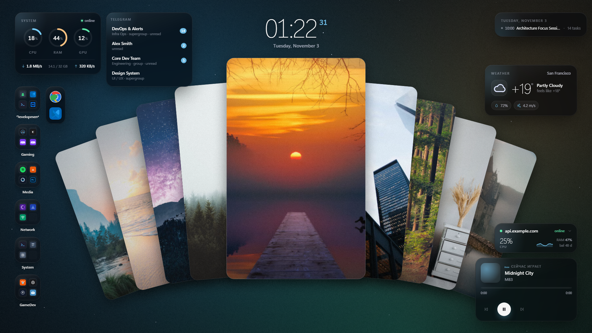
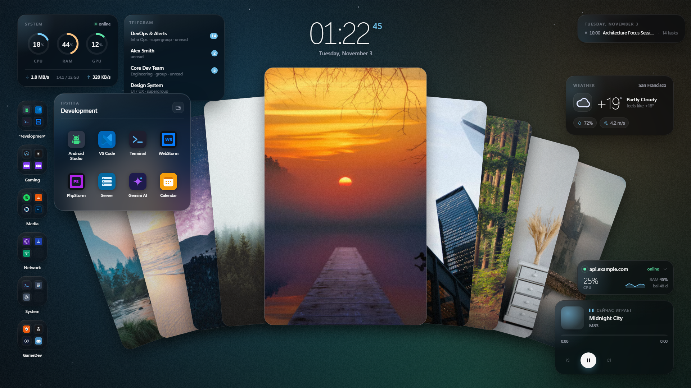
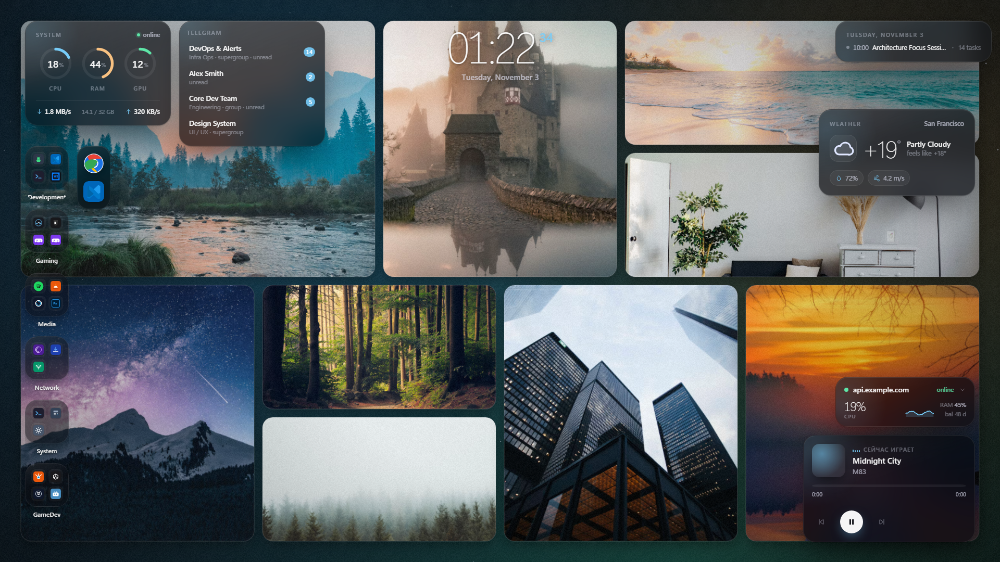
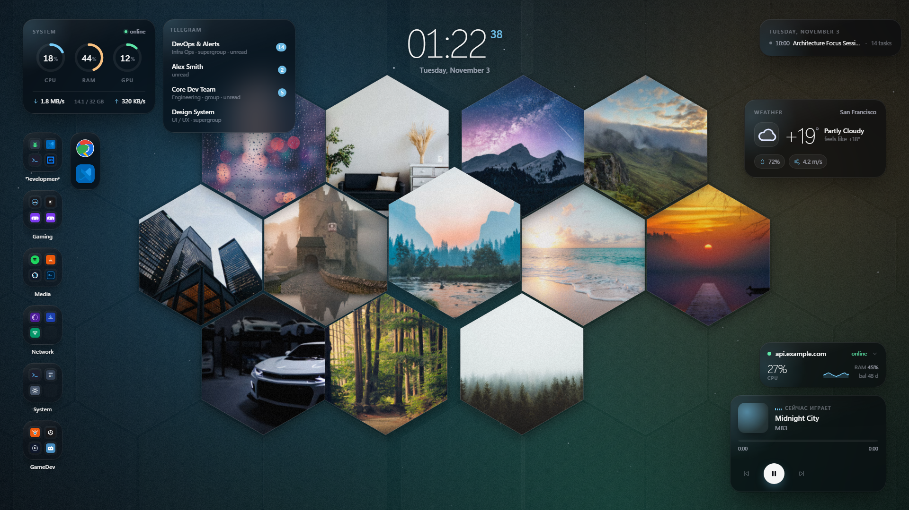
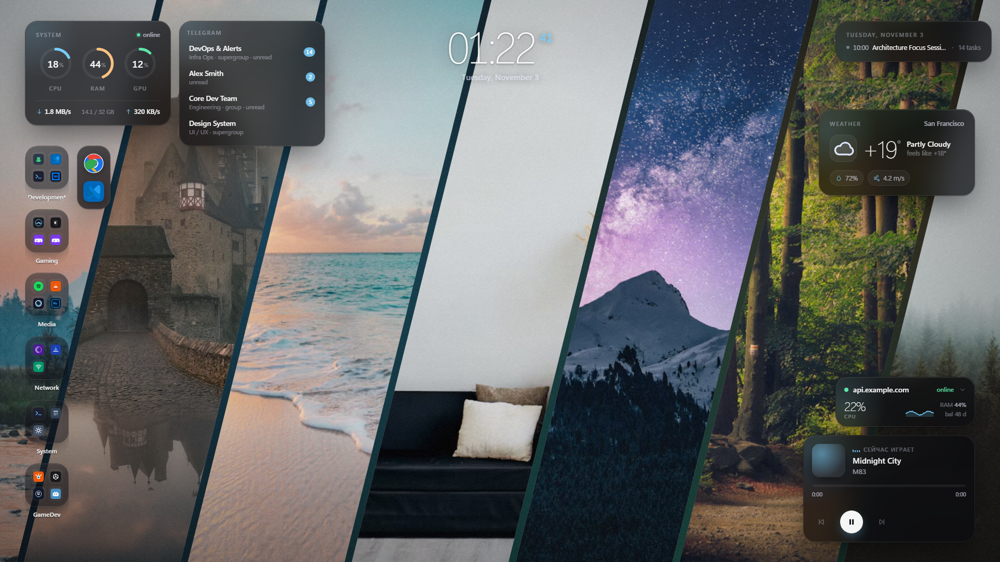
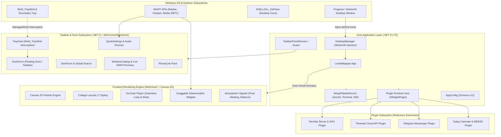

# Atoll Desktop

[English](README.md) | [Русский](README.ru.md)

---

An extensible, high-performance desktop environment suite and native Taskbar/Dock for Windows 10 and Windows 11 (including 24H2 and 26H1). 

**Atoll Desktop** integrates hardware-accelerated wallpapers, a glassmorphic desktop widget subsystem, ambient monitoring signals, hardware peripheral RGB synchronization, and a standalone taskbar/dock replacement.

Built on **C# (.NET 8 LTS)**, **Microsoft WebView2 (Chromium)**, and a **TypeScript / Vite** web layer.

<p align="center">
  
</p>

<p align="center">
  
</p>

### Dynamic Wallpaper & Collage Styles
Switch seamlessly between animated collage layout modes:

| Fan / Cards | Bento Grid |
| :---: | :---: |
|  |  |

| Honeycomb Hex | Diagonal Ribbons |
| :---: | :---: |
|  |  |

---

## 1. System Architecture



---

## 2. Core Components & Modules

| Module | Target Framework | Purpose |
|---|---|---|
| **`LiveWallpaper.App`** | `net8.0-windows` | Core desktop host. Manages WorkerW injection, system tray integration, settings window, hotkeys, and application lifecycle. |
| **`LiveWallpaper.Core`** | `net8.0` | Domain models, configuration schema (v13), migration engine, wallpaper URL parsers, and telemetry contracts. |
| **`LiveWallpaper.Native`** | `net8.0-windows` | P/Invoke interop with User32, Shell32, DwmApi, and Windows accent registry bridges. Handles `SHELLDLL_DefView` toggle. |
| **`LiveWallpaper.Services`** | `net8.0` | Background domain services: SSH `/proc` monitoring stream, Calendar (ICS), and palette synchronization. |
| **`LiveWallpaper.Web`** | `TypeScript 5 / Vite` | Interactive UI layer running inside WebView2. Renders collages, particles, YouTube background, and movable glassmorphic widgets. |
| **`TaskbarSpike`** | `net8.0-windows10.0.19041.0` | **Experimental Beta / In Development.** Standalone taskbar and macOS-style dock replacement. Features custom system tray hosting, native start menu, quick settings, and window preview thumbnails. |
| **`RedragonRgb`** | `net8.0` | Direct USB HID controller for Redragon mechanical keyboards (Garen Pro / K628 and compatible). Syncs peripheral lighting without vendor bloatware. |

---

## 3. Extensible Plugin & Widget Architecture

Atoll Desktop isolates specialized third-party services from the rendering core using a modular **Plugin & Widget Architecture**. The host coordinates background polling and credential storage, while the frontend dynamically mounts glassmorphic widgets.

### 3.1 Plugin Lifecycle & Contract

Plugins implement standard host-side interfaces to expose telemetry, credentials, and actions:

```csharp
public interface IWidgetPlugin
{
    string Id { get; }
    string DisplayName { get; }
    
    // Lifecycle
    Task InitializeAsync(IPluginContext context, CancellationToken ct);
    Task ShutdownAsync(CancellationToken ct);

    // Data polling dispatched to WebView2 over IPC
    Task<PluginDataPayload?> PollSnapshotAsync(CancellationToken ct);

    // Invoked when the user interacts with the widget on the frontend
    Task HandleActionAsync(string action, JsonElement payload);
}
```

On the frontend, widgets subscribe to typed IPC packets and mount inside the freeform draggable layer:

```typescript
export interface IDesktopWidget {
  readonly id: string;
  mount(container: HTMLElement): void;
  update(payload: unknown): void;
  destroy(): void;
}
```

### 3.2 Reference Plugins

The repository bundles battle-tested reference plugins illustrating real-world integrations:

#### A. DevOps & Infrastructure Monitor (`plugin.server`)
- **Lightweight SSH Stream**: Non-intrusive stream reading `/proc/stat`, `/proc/meminfo`, and `/proc/net/dev` on remote Linux servers via `ssh.exe` without installing remote agents.
- **Sparkline Buffers**: 10-minute rolling history (300 points) for CPU, memory, and network throughput.
- **Health Checks**: HTTP endpoint status validation and TLS certificate expiration countdown.

#### B. Timeweb Cloud API Plugin (`plugin.timeweb`)
- **Cloud Metrics**: Monitors server power states, floating IPs, and S3 object storage bucket capacities.
- **Runway & Billing**: Live balance tracking and runway day estimation.
- **Backup Verification**: Alerts if automated disk snapshots are stale (> 36 hours).
- **Secure Credentials**: API tokens are resolved directly from the **Windows Credential Manager** (`cmdkey /generic:LiveWallpaper/Timeweb`) and are never written to disk in plain text.

#### C. Telegram Messenger Plugin (`plugin.telegram`)
- **Unread Message Counters**: Tracks badge counts for priority chats, channels, and direct messages.
- **Local Bridge**: Communicates over a lightweight local HTTP/MCP loopback bridge, eliminating the need for a secondary Telegram desktop session.

#### D. Today Agenda Plugin (`plugin.today`)
- **Google Calendar**: Parses private ICS calendar feeds into upcoming agenda cards.
- **WEEEK Task Management**: Synchronizes daily task boards, priorities, and status transitions via REST API.

---

## 4. Key Subsystems

### 4.1 Dynamic Wallpaper Subsystem
- **Smart Image Pin Collages**:
  - Automatically loads and indexes images from a designated folder (default: `%USERPROFILE%\Pictures\Pins`).
  - **7 Layout Algorithms**:
    - `fan`: Central hero pin with outer cards fanning outwards.
    - `bento`: Modular asymmetric grid inspired by modern design systems.
    - `hex`: Dense hexagonal honeycomb pattern.
    - `diagonal`: Slanted vertical perspective strips.
    - `polaroid`: Casually scattered vintage photo frames.
    - `masonry`: Continuous vertical waterfall grid.
    - `film`: Cinematic perforated film rolls.
  - **Color Harmony (K-Means)**: Analyzes dominant colors in HSV space ($k=3$) to generate a complementary dark gradient backdrop.
  - **Interactive Physics**: Cursor-reactive 3D parallax tilt, spring-physics cosmic dust particles, and click ripple effects.
- **YouTube Live Wallpaper**:
  - Streams any YouTube video or live broadcast as the desktop background.
  - Automatically parses and validates standard, short, live, and embed links.
  - Features muted background playback with zero user gesture warnings (`--autoplay-policy=no-user-gesture-required`), seamless looping, and audio toggle.
- **Zero Gaming Footprint (Auto-Pause)**:
  - Continuously monitors foreground applications using `SHQueryUserNotificationState` and display bounds.
  - Suspends WebView2 rendering (`TrySuspendAsync`), halts timers, and drops CPU utilization to **0.0%** upon detecting fullscreen games or workstation lock (`Win+L`).

### 4.2 Taskbar & macOS-Style Dock Replacement (`TaskbarSpike`) — *Experimental Beta*
> **⚠️ Beta / In Development Warning**: `TaskbarSpike` is currently an **experimental beta prototype** under active development and is **disabled by default** (`"Taskbar": { "Enabled": false }`). It is not yet recommended as a daily driver. Known limitations and active work-in-progress areas include:
> - Right-click context menus on hidden tray icons (UI Automation routing is undergoing stabilization).
> - Multi-monitor taskbar pinning and per-monitor DPI scaling edge cases.
> - Shell window activation behaviors under specific fullscreen transitions.
>
> To test the experimental taskbar, toggle **"Custom taskbar"** in Settings or set `"Taskbar": { "Enabled": true }` in `config.json`. Disabling it instantly restores the standard Windows 11 taskbar without restarting.
- **Dual Display Modes**:
  - **Floating Dock**: Floating pill centered at the bottom of the screen with auto-hide and smooth scaling.
  - **Classic Taskbar**: Edge-to-edge dock providing familiar Windows navigation.
- **Native Tray Hosting (`TrayHost`)**:
  - Implements the `Shell_TrayWnd` interception pattern (Cairo/ManagedShell approach).
  - Captures `WM_COPYDATA` / `SHELLTRAYDATA` from background processes without corrupting Explorer's `AppBar` communications, enabling native context menus and tray icons in the custom dock.
- **Quick Settings Center (`QuickSettings` & `QuickForm`)**:
  - Master volume slider and live audio endpoint selector using Windows CoreAudio APIs.
  - Bluetooth radio toggle via WinRT `Windows.Devices.Radios`.
  - Mobile Hotspot toggle via `NetworkOperatorTetheringManager`.
  - Display brightness and Wi-Fi network panel.
- **Start Menu & Search (`StartForm`, `SearchCatalog`, `StartFeed`)**:
  - Categorized pinned application launchpad.
  - Instant application and file search.
  - Integrated customizable news/status feed.
- **Live Window Previews (`PreviewForm` & `WindowCatalog`)**:
  - Real-time DWM Thumbnail previews on icon hover.
  - Multi-window grouping with single-click focus or close actions.
- **Phone Link Integration (`PhoneLink` & `PhonePane`)**:
  - Displays linked Android/iOS smartphone battery percentage, cellular signal, and recent media snapshots.
- **Failsafe Taskbar Guard (`TaskbarGuard`)**:
  - Safely hides the Windows taskbar during operation and restores standard Explorer navigation on shutdown or crash via `restore_taskbar.bat`.

### 4.3 Contextual Modes & Ambient Notification Signals
- **Context Modes (`Auto`, `Work`, `Game`, `Night`)**:
  - Automatically adapts the workspace layout based on the active application, full-screen state, or time of day.
  - Selectively reveals or hides specific widget sets and switches color presets.
- **Ambient Edge Lighting Signals**:
  - **Production Outage Alert (`prodAlert`)**: Subtle pulsing red perimeter on the desktop when monitored production infrastructure fails.
  - **Upcoming Meeting Alert (`upcomingCall`)**: Warm amber aura radiating before scheduled calendar calls.
  - **Low Cloud Balance Alert (`lowBalance`)**: Amber indicator when cloud billing credits drop below threshold.

### 4.4 Hardware & Ecosystem Palette Synchronization
- **System Theme Matching**:
  - Pushes extracted wallpaper palette colors into Windows Accent Colors via `WindowsAccentHelper`.
  - Automatically updates Windows Terminal color profiles on wallpaper change.
- **Direct Hardware HID Lighting (`RedragonRgb`)**:
  - Low-level direct USB HID protocol for Redragon mechanical keyboards.
  - Synchronizes physical keyboard backlighting with desktop wallpaper palette in real time, bypassing proprietary OEM utilities.
  - Extensible via OpenRGB integration.

---

## 5. Configuration (`config.json`)

The configuration file is stored at `%LOCALAPPDATA%\LiveWallpaper\config.json` and supports live reloading without application restart:

```json
{
  "SchemaVersion": 13,
  "Collage": {
    "PinsDirectory": "C:\\Users\\Username\\Pictures\\Pins",
    "IntervalMinutes": 5,
    "Style": "fan",
    "ShuffleStyle": false,
    "MaxHistoryCount": 20,
    "EnableColorHarmony": true
  },
  "Wallpaper": {
    "YoutubeUrl": "https://www.youtube.com/watch?v=jfKfPfyJRdk",
    "SoundEnabled": false
  },
  "Taskbar": {
    "Enabled": false
  },
  "Context": {
    "Mode": "auto"
  },
  "Atmosphere": {
    "Enabled": true,
    "ProdAlertEnabled": true,
    "UpcomingCallMinutes": 10,
    "LowBalanceThresholdDays": 5
  },
  "SetupPalette": {
    "SyncWindowsAccent": true,
    "SyncWindowsTerminal": true,
    "SyncRedragonKeyboard": true
  },
  "Server": {
    "Enabled": true,
    "SshAlias": "myserver",
    "MetricsIntervalSec": 2,
    "Sites": [
      { "Name": "Production API", "Url": "https://api.example.com" }
    ],
    "TimewebEnabled": true,
    "PrivacyMode": false
  },
  "Today": {
    "Enabled": true,
    "CalendarIcsUrl": "https://calendar.google.com/calendar/ical/.../basic.ics"
  },
  "Telegram": {
    "Enabled": true
  },
  "Performance": {
    "FpsIdle": 30,
    "FpsTransition": 60,
    "AutoPauseFullscreen": true,
    "AutoPauseBattery": true,
    "BlockedProcesses": ["games.exe"]
  }
}
```

> **Security Note**: Sensitive credentials (such as Timeweb Cloud API tokens and WEEEK tokens) are stored securely inside the **Windows Credential Manager** (`cmdkey /generic:LiveWallpaper/Timeweb /user:token /pass:<SECRET>`) and are never written to disk in plain text.

---

## 6. Hotkeys

| Combination | Action |
|---|---|
| `Win + Alt + W` | Rotate wallpaper / random pin collage immediately |
| `Win + Alt + P` | Toggle rendering pause / resume |
| `Win + Alt + H` | Toggle privacy mode (hides server metrics and sensitive monitors) |

---

## 7. Building from Source

### Prerequisites
- **Windows 10 / 11 (64-bit)**
- **.NET 8.0 SDK** (v8.0.100 or newer)
- **Node.js 18+** & **npm**

```powershell
# 1. Clone repository
git clone https://github.com/prod-broke-again/atoll-desktop.git
cd atoll-desktop

# 2. Build the web frontend
cd src/LiveWallpaper.Web
npm install
npm run build
cd ../..

# 3. Execute test suite
dotnet test LiveWallpaper.sln

# 4. Run the application
dotnet run --project src/LiveWallpaper.App/LiveWallpaper.App.csproj
```
