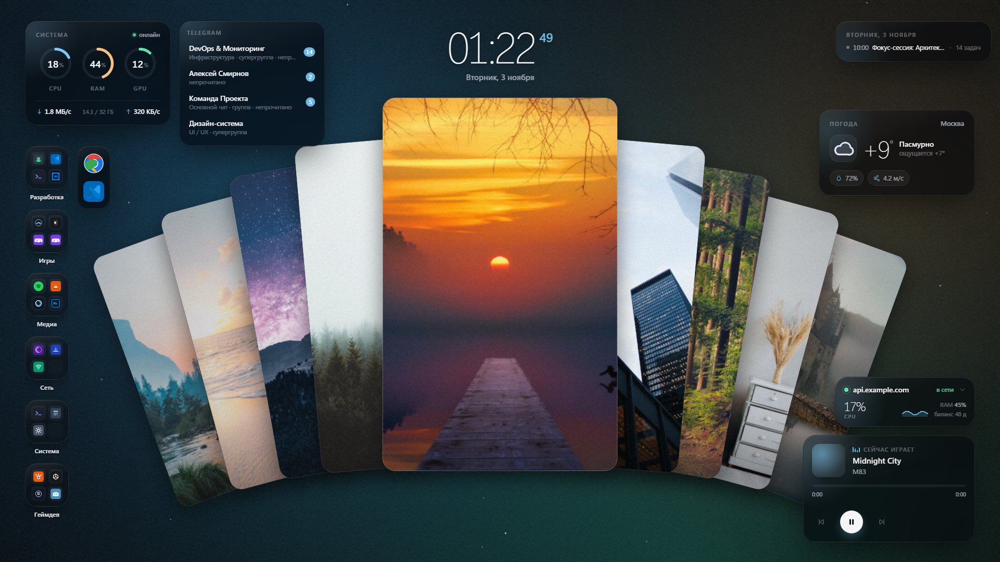
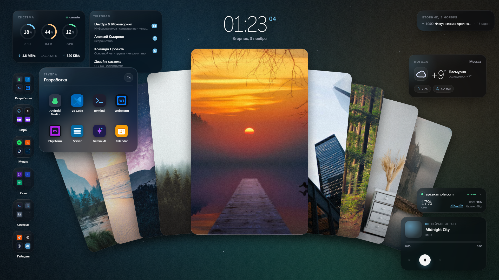
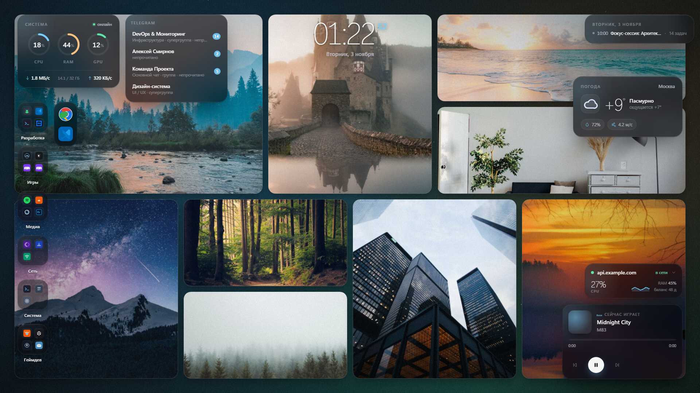
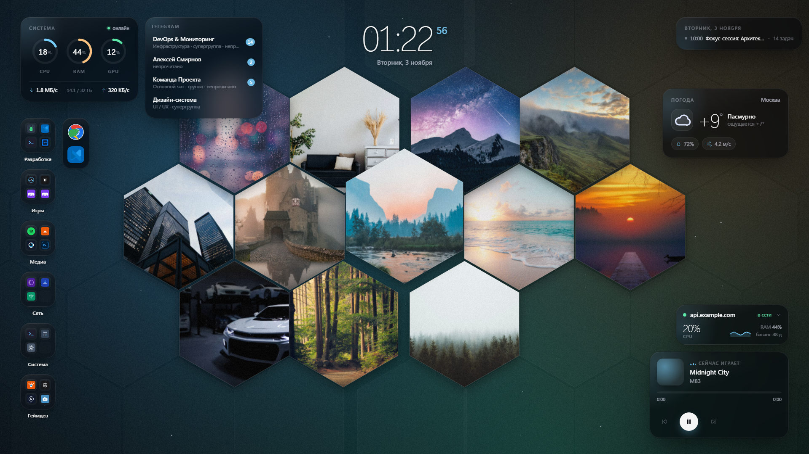
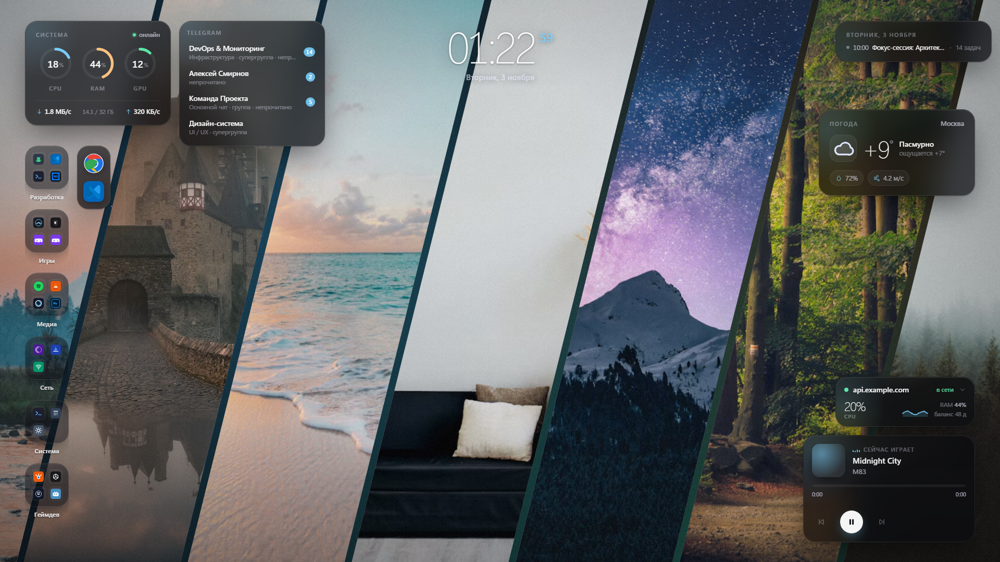
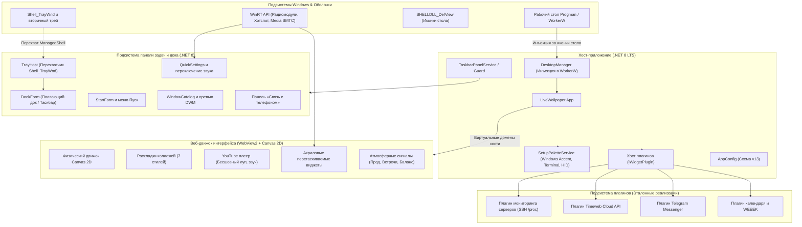

# Atoll Desktop

[English](README.md) | [Русский](README.ru.md)

---

Высокопроизводительный модульный комплекс рабочего окружения и нативный Taskbar/Dock для Windows 10 и Windows 11 (включая 24H2 и 26H1).

**Atoll Desktop** объединяет аппаратный движок живых обоев, систему интерактивных акриловых виджетов, фоновые сигналы мониторинга, синхронизацию подсветки периферии и независимую замену панели задач Windows на базе нативного Dock-интерфейса.

Стек: **C# (.NET 8 LTS)**, **Microsoft WebView2 (Chromium)** и веб-слой на **TypeScript / Vite**.

<p align="center">
  
</p>

<p align="center">
  
</p>

### Режимы коллажей и динамических обоев
Быстрое переключение между процедурными стилями раскладки:

| Веер / Карточки (Fan) | Сетка Bento (Grid) |
| :---: | :---: |
|  |  |

| Соты (Hex Honeycomb) | Диагональные ленты (Diagonal) |
| :---: | :---: |
|  |  |

---

## 1. Архитектура системы



---

## 2. Состав модулей и проектов

| Проект | Целевая платформа | Назначение |
|---|---|---|
| **`LiveWallpaper.App`** | `net8.0-windows` | Главный исполняемый хост: инъекция окна в иерархию WorkerW, трей, окно настроек, глобальные хоткеи и жизненный цикл. |
| **`LiveWallpaper.Core`** | `net8.0` | Доменные модели, схема конфигурации v13, движок миграций, парсер ссылок YouTube и контракты телеметрии. |
| **`LiveWallpaper.Native`** | `net8.0-windows` | P/Invoke-вызовы к User32, Shell32, DwmApi и реестру. Управление отображением иконок рабочего стола (`SHELLDLL_DefView`). |
| **`LiveWallpaper.Services`** | `net8.0` | Фоновые службы: SSH `/proc` поток метрик, календарь Google (ICS), WEEEK API и синхронизация палитры. |
| **`LiveWallpaper.Web`** | `TypeScript 5 / Vite` | Интерактивный UI-слой в WebView2: коллажи, частицы, видеофон YouTube, перемещаемые виджеты Glassmorphism. |
| **`TaskbarSpike`** | `net8.0-windows10.0.19041.0` | **Экспериментальная бета в активной разработке.** Полноценная замена панели задач: системный трей, меню «Пуск», центр быстрых настроек, живые миниатюры окон и плавающий док в стиле macOS. |
| **`RedragonRgb`** | `net8.0` | Низкоуровневый драйвер прямого управления USB HID для клавиатур Redragon (Garen Pro / K628 и совместимых) без софта вендора. |

---

## 3. Расширяемая архитектура виджетов и плагинов

Специфичные интеграции со сторонними API и сервисами изолированы от графического ядра в рамках **модульной архитектуры плагинов (Plugin & Widget API)**. Хост берет на себя безопасное хранение ключей, таймеры опроса и передачу данных по IPC, а веб-слой монтирует соответствующие карточки.

### 3.1 Контракты и жизненный цикл

На стороне хоста C# плагин реализует стандартный интерфейс:

```csharp
public interface IWidgetPlugin
{
    string Id { get; }
    string DisplayName { get; }

    // Жизненный цикл плагина
    Task InitializeAsync(IPluginContext context, CancellationToken ct);
    Task ShutdownAsync(CancellationToken ct);

    // Опрос данных, отправляемых во фронтенд через IPC
    Task<PluginDataPayload?> PollSnapshotAsync(CancellationToken ct);

    // Обработка пользовательских действий с карточки виджета
    Task HandleActionAsync(string action, JsonElement payload);
}
```

На стороне веб-слоя виджет монтируется в свободный слой рабочего стола и обрабатывает типизированные события:

```typescript
export interface IDesktopWidget {
  readonly id: string;
  mount(container: HTMLElement): void;
  update(payload: unknown): void;
  destroy(): void;
}
```

### 3.2 Эталонные плагины (Reference Plugins)

В репозиторий включены готовые эталонные плагины, демонстрирующие интеграцию с облачными сервисами, мессенджерами и серверами:

#### A. Мониторинг инфраструктуры (`plugin.server`)
- **Легковесный SSH-поток**: Чтение `/proc/stat`, `/proc/meminfo` и `/proc/net/dev` на удаленном Linux-сервере через нативный системный `ssh.exe` без установки сторонних агентов.
- **Спарклайны истории**: Кольцевой буфер на 10 минут (300 измерений) для визуализации CPU, памяти и сетевого трафика.
- **Проверка доступности**: HTTP/HTTPS ping веб-сайтов и подсчет дней до истечения TLS-сертификатов.

#### B. Плагин Timeweb Cloud API (`plugin.timeweb`)
- **Метрики облака**: Статус серверов, плавающие IP-адреса, объем занятого диска и заполнение S3-бакетов.
- **Биллинг и баланс**: Текущий остаток средств и прогноз дней до исчерпания баланса.
- **Контроль бэкапов**: Автоматический алерт, если последний снимок диска старше 36 часов.
- **Безопасность**: API-токен хранится в **Диспетчере учётных данных Windows** (`cmdkey /generic:LiveWallpaper/Timeweb`) и никогда не попадает в открытые конфиги.

#### C. Плагин Telegram Messenger (`plugin.telegram`)
- **Счётчики непрочитанного**: Отображение количества входящих сообщений в приоритетных чатах, каналах и ЛС.
- **Локальный мост**: Взаимодействие через локальный HTTP/MCP loopback-мост без необходимости запуска отдельной тяжелой сессии клиента.

#### D. Плагин задач и расписания («Сегодня») (`plugin.today`)
- **Google Календарь**: Разбор приватного ICS-фида и формирование карточки ближайших встреч.
- **Таск-трекер WEEEK**: Синхронизация досок задач, приоритетов и статусов через REST API.

---

## 4. Ключевые подсистемы

### 4.1 Движок живых обоев и фона
- **Умные коллажи из локальных изображений**:
  - Мониторинг папки с пинами (`%USERPROFILE%\Pictures\Pins`) с мгновенным применением изменений.
  - **7 алгоритмов раскладки**:
    - `fan`: Центральная картина с карточками, раскрывающимися веером.
    - `bento`: Асимметричная модульная сетка в стиле современных дизайн-систем.
    - `hex`: Плотная шестиугольная ячеистая структура.
    - `diagonal`: Динамические наклонные полосы во весь экран.
    - `polaroid`: Разбросанные ретро-карточки с мягкими тенями.
    - `masonry`: Каскадная вертикальная лента без пустых зазоров.
    - `film`: Кинематографическая перфорированная кинолента.
  - **Цветовая гармония K-Means**: Анализ доминирующих оттенков в пространстве HSV ($k=3$) и создание глубокого градиентного фона.
  - **Физика и реакция на мышь**: 3D Parallax-наклон карточек, частицы космической пыли с пружинной физикой и волновые круги при кликах.
- **YouTube в роли живых обоев**:
  - Встраивание любого видео или прямой трансляции с YouTube по ссылке из настроек.
  - Корректная обработка ссылок форматов `watch`, `shorts`, `live`, `youtu.be` и embed.
  - Бесшовный цикл, автозапуск без системных предупреждений, опциональное включение звука.
- **Auto-Pause (0.0% CPU в играх)**:
  - Непрерывный опрос состояния `SHQueryUserNotificationState`.
  - При запуске полноэкранной игры или блокировке экрана (`Win+L`) рендеринг WebView2 немедленно замораживается (`TrySuspendAsync`), таймеры останавливаются, нагрузка на процессор падает до **0.0%**.

### 4.2 Замена панели задач Windows (`TaskbarSpike`) — *Экспериментальная бета-версия*
> **⚠️ Внимание / Статус бета-версии**: Модуль `TaskbarSpike` в настоящее время является **экспериментальным прототипом (бета)** в активной разработке и **по умолчанию выключен** (`"Taskbar": { "Enabled": false }`). Он пока не готов для постоянной повседневной работы. Известные ограничения и направления текущей отладки:
> - Контекстное меню по правому клику (ПКМ) на скрытых значках трея (маршрутизация через UI Automation находится в процессе стабилизации).
> - Сценарии с несколькими мониторами и краевые случаи масштабирования DPI.
> - Поведение активации окон при возврате из специфических полноэкранных приложений.
>
> Для тестирования экспериментальной панели включите переключатель **«Своя панель задач (Бета)»** в настройках или установите `"Taskbar": { "Enabled": true }` в `config.json`. При выключении штатная панель Windows 11 немедленно возвращается без перезапуска системы.
- **Два режима отображения**:
  - **Плавающий Док (macOS style)**: Компактная скруглённая панель по центру экрана с авто-скрытием.
  - **Классический Таскбар**: Полноразмерная панель во всю ширину экрана.
- **Собственный хост системного трея (`TrayHost`)**:
  - Перехватчик `Shell_TrayWnd` (метод Cairo / ManagedShell).
  - Приём `WM_COPYDATA` / `SHELLTRAYDATA` от фоновых программ без поломки `AppBar` проводника: нативные значки трея и всплывающие контекстные меню Windows работают прямо в кастомной панели.
- **Центр управления (`QuickSettings`)**:
  - Регулировка общей громкости и мгновенное переключение устройства вывода звука (CoreAudio).
  - Управление Bluetooth (WinRT `Windows.Devices.Radios`).
  - Управление мобильным хотспотом (`NetworkOperatorTetheringManager`).
  - Ползунок яркости экрана и быстрый выбор сетей Wi-Fi.
- **Меню «Пуск» и поиск (`StartForm`, `SearchCatalog`)**:
  - Категоризированный список закреплённых приложений.
  - Глобальный поиск по программам и файлам.
  - Интегрированная новостная / статусная лента (`StartFeed`).
- **Живые превью окон (`PreviewForm`)**:
  - Миниатюры запущенных окон на базе DWM Thumbnail при наведении на значки приложений.
  - Группировка окон одного приложения, быстрое переключение и закрытие.
- **Связь с телефоном (`PhoneLink`)**:
  - Индикатор заряда батареи смартфона, уровень сети и последние медиафайлы.
- **Безопасность (`TaskbarGuard`)**:
  - Безопасное сокрытие стандартного таскбара Windows и автоматическое восстановление при выходе или аварийном завершении (`restore_taskbar.bat`).

### 4.3 Контекстные режимы и сигналы атмосферы
- **Режимы окружения (`Auto`, `Work`, `Game`, `Night`)**:
  - Автоматическая адаптация профиля в зависимости от открытого софта, полноэкранного режима или времени суток.
  - Автоматическое скрытие/показ виджетов и подстройка цветовых схем.
- **Фоновые сигналы по краям экрана**:
  - **Сбой серверов (`prodAlert`)**: Мягкое пульсирующее красное свечение по периметру экрана при падении инфраструктуры.
  - **Скоро созвон (`upcomingCall`)**: Тёплый янтарный ореол за N минут до встречи в календаре.
  - **Низкий баланс (`lowBalance`)**: Предупреждающий световой акцент при исчерпании средств на сервере.

### 4.4 Синхронизация палитры и периферии
- **Тема Windows и терминала**:
  - Передача акцентного цвета обоев в палитру Windows (`WindowsAccentHelper`).
  - Автоматическое обновление цветовой схемы Windows Terminal под тон активных обоев.
- **Прямой драйвер подсветки клавиатуры (`RedragonRgb`)**:
  - Прямое управление контроллером клавиатуры через USB HID без установки фирменного софта производителя.
  - Поддержка Redragon Garen Pro / K628 и аналогов.
  - Опциональная интеграция с OpenRGB.

---

## 5. Конфигурация (`config.json`)

Конфиг расположен по адресу `%LOCALAPPDATA%\LiveWallpaper\config.json` и перезагружается на лету:

```json
{
  "SchemaVersion": 13,
  "Collage": {
    "PinsDirectory": "C:\\Users\\Username\\Pictures\\Pins",
    "IntervalMinutes": 5,
    "Style": "fan",
    "ShuffleStyle": false,
    "MaxHistoryCount": 20,
    "EnableColorHarmony": true
  },
  "Wallpaper": {
    "YoutubeUrl": "https://www.youtube.com/watch?v=jfKfPfyJRdk",
    "SoundEnabled": false
  },
  "Taskbar": {
    "Enabled": false
  },
  "Context": {
    "Mode": "auto"
  },
  "Atmosphere": {
    "Enabled": true,
    "ProdAlertEnabled": true,
    "UpcomingCallMinutes": 10,
    "LowBalanceThresholdDays": 5
  },
  "SetupPalette": {
    "SyncWindowsAccent": true,
    "SyncWindowsTerminal": true,
    "SyncRedragonKeyboard": true
  },
  "Server": {
    "Enabled": true,
    "SshAlias": "myserver",
    "MetricsIntervalSec": 2,
    "Sites": [
      { "Name": "Production API", "Url": "https://api.example.com" }
    ],
    "TimewebEnabled": true,
    "PrivacyMode": false
  },
  "Today": {
    "Enabled": true,
    "CalendarIcsUrl": "https://calendar.google.com/calendar/ical/.../basic.ics"
  },
  "Telegram": {
    "Enabled": true
  },
  "Performance": {
    "FpsIdle": 30,
    "FpsTransition": 60,
    "AutoPauseFullscreen": true,
    "AutoPauseBattery": true,
    "BlockedProcesses": ["games.exe"]
  }
}
```

> **Безопасность**: Токены Timeweb Cloud и WEEEK хранятся в защищённом **Диспетчере учётных данных Windows** (`cmdkey /generic:LiveWallpaper/Timeweb /user:token /pass:<TOKEN>`) и никогда не записываются открытым текстом в конфиг или логи.

---

## 6. Горячие клавиши

| Сочетание | Действие |
|---|---|
| `Win + Alt + W` | Сменить коллаж / сгенерировать новую раскладку обоев |
| `Win + Alt + P` | Поставить на паузу / возобновить анимацию |
| `Win + Alt + H` | Режим приватности (скрыть конфиденциальные метрики серверов) |

---

## 7. Сборка из исходного кода

### Требования
- **Windows 10 / 11 (x64)**
- **.NET 8.0 SDK** (v8.0.100+)
- **Node.js 18+** и **npm**

```powershell
# 1. Клонирование репозитория
git clone https://github.com/prod-broke-again/atoll-desktop.git
cd atoll-desktop

# 2. Сборка веб-фронтенда
cd src/LiveWallpaper.Web
npm install
npm run build
cd ../..

# 3. Запуск автоматических тестов
dotnet test LiveWallpaper.sln

# 4. Запуск приложения
dotnet run --project src/LiveWallpaper.App/LiveWallpaper.App.csproj
```
